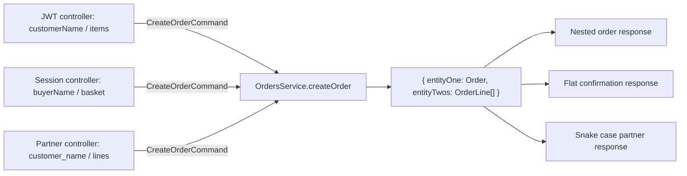
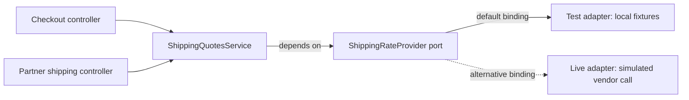

# NestJS controller mapping demo

Three controllers with different DTOs and authentication methods call the same `OrdersService.createOrder()` method. The service returns an order and its lines as `{ entityOne, entityTwos }`. Each controller explicitly maps both entities into its own response DTO.

Two more controllers share `ShippingQuotesService`, which depends on a provider port. A local `test` adapter lets you test the actual business rules without paying for provider calls; a simulated `live` adapter shows where the external integration would go. There are five controllers total and two business services.

## The seams to show your teammate

| Layer                 | Owns                                                                        | Depends on                                    |
| --------------------- | --------------------------------------------------------------------------- | --------------------------------------------- |
| `controllers/`        | Each API's request/response DTOs and explicit mappings                      | Auth identity, business commands and services |
| `auth/`               | Credential verification, cached sessions, normalized `{ id }` identity      | Nest/HTTP and demo configuration              |
| `business/`           | Commands, entities, value invariants, pricing rules, provider port          | Its own types and Node built-ins              |
| `providers/shipping/` | Vendor request/response mapping, vendor failure translation, local fixtures | The business-owned provider port              |
| `http/`               | Business-error to HTTP-status translation                                   | Business error types                          |
| `composition/`        | Nest modules, factories, and the commented adapter switch                   | The concrete pieces it connects               |

The business services are plain TypeScript classes with no Nest decorators, HTTP DTOs, auth implementations, or concrete adapter imports. API DTOs define their own contracts. The shipping port defines normalized rates in USD cents; vendor field names never reach the service.

The two mappings around the shipping service have separate jobs:

```text
API DTO → controller → business command
                         ↓
                 ShippingQuotesService → provider port
                                           ↑ implements
                                    live / test adapter
                                           ↕
                               vendor DTOs / local fixtures

business result → controller → API response DTO
business error  → HTTP filter → HTTP error response
```

Start the walkthrough with a controller, follow its command into the service, then open [the shipping module](src/composition/shipping.module.ts). Its factory supplies the selected adapter to the plain service's constructor:

```ts
{
  provide: ShippingQuotesService,
  inject: [SHIPPING_RATE_PROVIDER],
  useFactory: (provider: ShippingRateProvider) => new ShippingQuotesService(provider),
}
```

The [auth module](src/auth/auth.module.ts) provisions the demo session at startup. `SessionCacheService` itself starts empty and only manages cached sessions. Both feature modules import the same auth module, so they share its cache.

## Run it

Uses NestJS 11 and TypeScript. Requires Node.js 22.14+ and npm.

```sh
npm install
npm run build
npm start
```

In another terminal, call all five endpoints and print their different responses:

```sh
npm run demo
```

For development, use `npm run start:dev`. To check the app, run `npm run typecheck` and `npm test`.

The app binds to `127.0.0.1:3000`. Optional configuration lives in `.env.example`; copy it to `.env` to override the defaults. Rebuild after code changes when using `npm start` or the credential script.

## Follow the flow



| Endpoint               | Authentication                   | Request DTO             | Response DTO              |
| ---------------------- | -------------------------------- | ----------------------- | ------------------------- |
| `POST /jwt/orders`     | `Authorization: Bearer <JWT>`    | `JwtCreateOrderDto`     | `JwtOrderResponseDto`     |
| `POST /session/orders` | `X-Session-Id: demo-session`     | `SessionCreateOrderDto` | `SessionOrderResponseDto` |
| `POST /partner/orders` | `X-Api-Token: demo-static-token` | `PartnerCreateOrderDto` | `PartnerOrderResponseDto` |

Read these files together during the walkthrough:

1. [Business command and result](src/business/order.models.ts): plain TypeScript types shared by the controllers.
2. [Business service](src/business/orders.service.ts): logs the command, creates the order and lines, and calculates the total quantity. It has no knowledge of headers or HTTP DTOs.
3. [JWT controller](src/controllers/jwt/jwt-orders.controller.ts), [session controller](src/controllers/session/session-orders.controller.ts), and [partner controller](src/controllers/partner/partner-orders.controller.ts): map request → command and business result → response. Each injects the same singleton service. Response fields are selected explicitly rather than spreading business entities into the output.
4. [Auth guards and session cache](src/auth): authenticate each request and normalize its identity to `{ id }`. The `@CurrentActor()` decorator passes that identity to the controller, which supplies `actorId` to the service.

The similar controller code is intentional: each API owns its mapping, and the demo makes each mapping visible. Their request and response DTOs sit next to their controllers; adding a field to one API does not require changing the others.

## The shared business contract

All three sample requests become the same command:

```ts
{
  actorId: 'demo-user',
  customerName: 'Ada',
  items: [{ sku: 'BOOK', quantity: 2 }]
}
```

The service returns this structure. IDs below are placeholders for generated UUIDs:

```json
{
  "entityOne": {
    "id": "order-uuid",
    "customerName": "Ada",
    "createdBy": "demo-user",
    "status": "accepted",
    "totalQuantity": 2
  },
  "entityTwos": [
    {
      "id": "line-uuid",
      "orderId": "order-uuid",
      "sku": "BOOK",
      "quantity": 2
    }
  ]
}
```

The controllers compose and rename these entities, omit internal `createdBy` and `orderId` fields, and return HTTP `201` with the contracts below.

## JWT API

After building, generate a fresh one-hour JWT:

```sh
npm run credentials
```

The command prints JSON containing `jwt`, `sessionId`, and `staticToken`. Paste the JWT into this request:

```sh
curl -X POST http://127.0.0.1:3000/jwt/orders \
  -H 'Content-Type: application/json' \
  -H 'Authorization: Bearer <paste-jwt-here>' \
  -d '{"customerName":"Ada","items":[{"sku":"BOOK","quantity":2}]}'
```

```json
{
  "order": {
    "id": "order-uuid",
    "customerName": "Ada",
    "status": "accepted",
    "totalQuantity": 2,
    "items": [{ "id": "line-uuid", "sku": "BOOK", "quantity": 2 }]
  }
}
```

The guard verifies the HS256 signature, issuer, audience, expiration, and subject. The verified subject supplies the actor ID.

## Session API

```sh
curl -X POST http://127.0.0.1:3000/session/orders \
  -H 'Content-Type: application/json' \
  -H 'X-Session-Id: demo-session' \
  -d '{"buyerName":"Ada","basket":[{"productCode":"BOOK","units":2}]}'
```

```json
{
  "confirmation": "order-uuid",
  "buyer": "Ada",
  "accepted": true,
  "totalUnits": 2,
  "basket": [
    { "lineReference": "line-uuid", "productCode": "BOOK", "units": 2 }
  ]
}
```

`SessionCacheService` stores sessions in a `Map`, checks expiration on lookup, and supports insertion and deletion. The app seeds `demo-session` for `demo-user` for one hour at startup. Restart the app to reseed it. Generating credentials prints the session ID; it does not renew the server session.

## Static token API

```sh
curl -X POST http://127.0.0.1:3000/partner/orders \
  -H 'Content-Type: application/json' \
  -H 'X-Api-Token: demo-static-token' \
  -d '{"customer_name":"Ada","lines":[{"product_code":"BOOK","count":2}]}'
```

```json
{
  "order_ref": "order-uuid",
  "customer_name": "Ada",
  "state": "ACCEPTED",
  "total_units": 2,
  "line_items": [
    { "line_ref": "line-uuid", "product_code": "BOOK", "count": 2 }
  ]
}
```

The static token identifies the demo integration as `demo-user`. Override `STATIC_AUTH_TOKEN` in `.env` if desired and use that value in requests.

## Provider port demo: shipping quotes

| Endpoint                         | Authentication | Request DTO                  | Response DTO                  |
| -------------------------------- | -------------- | ---------------------------- | ----------------------------- |
| `POST /checkout/shipping-quotes` | Bearer JWT     | `CheckoutShippingRequestDto` | `CheckoutShippingResponseDto` |
| `POST /partner/shipping-quotes`  | `X-Api-Token`  | `PartnerShippingRequestDto`  | `PartnerShippingResponseDto`  |

Both controllers map their request into `CreateShippingQuoteCommand` and call the same real `ShippingQuotesService`. It returns `{ entityOne: quote, entityTwos: chargeLines }`, which each controller maps into its own response contract.



The port supplies a carrier rate and delivery estimate. The service owns these business rules:

- Add a 200-cent handling fee to the provider's rate.
- At an order subtotal of 10,000 cents ($100) or more, waive both the carrier rate and handling fee.
- Return the final customer charge and a breakdown whose signed amounts sum to that charge.

The service rejects invalid commands before requesting a rate, then verifies the normalized provider result's currency and numeric constraints before pricing the quote. Adapters translate vendor exceptions into `ShippingRateUnavailableError`; the [HTTP filter](src/http/business-exception.filter.ts) alone decides that this becomes a `502` response. Business code never throws Nest HTTP exceptions.

All amounts are integer USD cents, including Canadian destination fixtures. Countries are limited to `US` and `CA` to keep the example small. The local adapter returns fixed rates independent of package weight: 500 cents / 3 days for US and 1,000 cents / 7 days for CA.

### Switch adapters here

Open **[src/composition/shipping-provider.binding.ts](src/composition/shipping-provider.binding.ts)**. Keep exactly one `useClass` line uncommented:

```ts
export const shippingProviderBinding: ClassProvider<ShippingRateProvider> = {
  provide: SHIPPING_RATE_PROVIDER,

  useClass: TestShippingRateAdapter, // ACTIVE: local fixtures, zero provider cost.
  // useClass: LiveShippingRateAdapter, // Comment the line above and uncomment this for live mode.
};
```

Rebuild and restart after switching (`npm run start:dev` restarts automatically). Both adapters implement the same [port](src/business/shipping/shipping-rate.port.ts). The service and controllers stay the same.

The [live adapter](src/providers/shipping/live-shipping-rate.adapter.ts) logs a simulated outbound request and maps a vendor-shaped response into our port contract. It makes no network call and requires no credentials. In a real app, put the vendor SDK/HTTP call there. With the same US request below, simulated live mode returns a 925-cent carrier rate plus the 200-cent handling fee, for a total of 1,125 cents.

### Different DTOs, same service

Use the JWT from `npm run credentials`:

```sh
curl -X POST http://127.0.0.1:3000/checkout/shipping-quotes \
  -H 'Content-Type: application/json' \
  -H 'Authorization: Bearer <paste-jwt-here>' \
  -d '{"destinationCountry":"US","weightGrams":1500,"orderSubtotalCents":5000}'
```

With the default test adapter:

```json
{
  "quote": {
    "id": "quote-uuid",
    "carrier": "test-carrier",
    "estimatedDays": 3,
    "currency": "USD",
    "totalCents": 700,
    "freeShipping": false,
    "breakdown": [
      { "label": "carrier", "amountCents": 500 },
      { "label": "handling", "amountCents": 200 },
      { "label": "discount", "amountCents": 0 }
    ]
  }
}
```

The partner sends different field names:

```sh
curl -X POST http://127.0.0.1:3000/partner/shipping-quotes \
  -H 'Content-Type: application/json' \
  -H 'X-Api-Token: demo-static-token' \
  -d '{"destination_country":"US","package_weight_grams":1500,"order_value_cents":5000}'
```

```json
{
  "quote_ref": "quote-uuid",
  "carrier_name": "test-carrier",
  "delivery_days": 3,
  "currency_code": "USD",
  "shipping_charge_cents": 700,
  "shipping_waived": false,
  "charge_lines": [
    { "code": "CARRIER", "value_cents": 500 },
    { "code": "HANDLING", "value_cents": 200 },
    { "code": "DISCOUNT", "value_cents": 0 }
  ]
}
```

Change the subtotal to `10000` in either request: the service returns a zero customer charge and a `-700` discount line with the US test fixture.

### Test our logic without provider costs

```sh
npm run test:shipping
```

[Service tests](test/shipping.service.spec.ts) instantiate the **real business service** with `TestShippingRateAdapter`. They check handling fees, the exact free-shipping threshold, different provider rates, breakdown totals, and failure propagation. They construct the service directly without a Nest container. They do not mock `ShippingQuotesService` or precompute its business result.

```ts
const provider = new TestShippingRateAdapter();
const service = new ShippingQuotesService(provider);
const result = await service.createQuote(command);
```

[HTTP tests](test/shipping.e2e.spec.ts) run both real controllers, guards, validation, and the real service. They explicitly replace the provider token:

```ts
const module = await Test.createTestingModule({ imports: [AppModule] })
  .overrideProvider(SHIPPING_RATE_PROVIDER)
  .useClass(TestShippingRateAdapter)
  .compile();
```

This override stays local even if you change the application's binding to live. The tests check the injected adapter and assert that the live adapter is never constructed. A shared Jest setup replaces the live adapter module with a constructor that throws before any vendor code can run. Only the external boundary is substituted; the internal logic you want confidence in still executes.

[Architecture checks](test/architecture.spec.ts) also prevent business code from importing Nest or outer layers, keep API DTOs independent of business/provider types, and keep concrete provider selection out of controllers and services. [Order service tests](test/orders.service.spec.ts) demonstrate the same direct construction for the original example.

## Scope and checks

This is a local teaching app: credentials are public demo values, sessions are held in one process, and orders are logged and returned without persistence. Credentials are provisioned locally instead of through additional login endpoints. Both shipping adapters are cost-free demo implementations. Every order or quote call creates new IDs, so IDs differ between examples.

Request validation checks API field names, types, and nested DTOs. The plain business services also enforce their value invariants for typed callers such as jobs or scripts. Invalid requests or business inputs return `400`; missing, invalid, or expired credentials return `401`. Provider failures use a business-owned error that the HTTP filter translates into `502` with a stable message; vendor details and causes stay internal.

The order HTTP tests exercise the original three real controllers and their shared service, compare normalized commands and response mappings, and cover credential isolation, JWT failures, session expiry/deletion, trusted actor identity, and nested DTO validation. The shipping tests add the provider-port example described above.

NestJS references: [controllers](https://docs.nestjs.com/controllers), [authentication](https://docs.nestjs.com/security/authentication), [validation](https://docs.nestjs.com/techniques/validation), [custom providers](https://docs.nestjs.com/fundamentals/custom-providers), and [testing](https://docs.nestjs.com/fundamentals/testing).
